

  

  <a href="https://github.com/Giuseph66#gh-dark-mode-only">
    <picture>
      <source media="(max-width: 600px)" srcset="./assets/profile-terminal-mobile.svg" />
      
    </picture>
  </a>
  <a href="https://github.com/Giuseph66#gh-light-mode-only">
    <picture>
      <source media="(max-width: 600px)" srcset="./assets/profile-terminal-mobile-light.svg" />
      
    </picture>
  </a>

  
  
  
  

---

## About me

I've been programming since late 2022, and it quickly went from a college subject to what I do every day. I'm currently finishing my Computer Engineering degree in Sinop, MT. According to my Linux machine, I've spent 12,382 hours in front of it since 2023, almost all of them writing code.

AI is part of how I learn. It lets me go deep on a new stack in weeks instead of months, which is how this profile covers mobile apps, backends, AI agents and embedded firmware. I've also published papers involving software and hardware, and a good part of my work lives in private repositories.

Coding is my job, but I'd do it anyway. What I enjoy most is the moment hardware joins in, when an ESP32 or an Arduino turns a few lines of code into something you can see and touch.

---

## Tech Stack

  <a href="https://github.com/Giuseph66?tab=repositories#gh-dark-mode-only">
    <picture>
      <source media="(max-width: 600px)" srcset="./assets/tech-stack-mobile.svg" />
      
    </picture>
  </a>
  <a href="https://github.com/Giuseph66?tab=repositories#gh-light-mode-only">
    <picture>
      <source media="(max-width: 600px)" srcset="./assets/tech-stack-mobile-light.svg" />
      
    </picture>
  </a>

---

## Featured Projects

<!-- featured:start -->
### AI & Automation

  <a href="https://github.com/Giuseph66/NEO_code#gh-dark-mode-only"></a>
  <a href="https://github.com/Giuseph66/NEO_code#gh-light-mode-only"></a>
  <a href="https://github.com/Giuseph66/server-rotate-key#gh-dark-mode-only"></a>
  <a href="https://github.com/Giuseph66/server-rotate-key#gh-light-mode-only"></a>
  <a href="https://github.com/Giuseph66/temporario-ath#gh-dark-mode-only"></a>
  <a href="https://github.com/Giuseph66/temporario-ath#gh-light-mode-only"></a>
  <a href="https://github.com/Giuseph66/NEO-assistente#gh-dark-mode-only"></a>
  <a href="https://github.com/Giuseph66/NEO-assistente#gh-light-mode-only"></a>

### Mobile & Apps

  <a href="https://github.com/Giuseph66/AgroTracer#gh-dark-mode-only"></a>
  <a href="https://github.com/Giuseph66/AgroTracer#gh-light-mode-only"></a>
  <a href="https://github.com/Giuseph66/PAP#gh-dark-mode-only"></a>
  <a href="https://github.com/Giuseph66/PAP#gh-light-mode-only"></a>
  <a href="https://github.com/Giuseph66/Neo-Mobile#gh-dark-mode-only"></a>
  <a href="https://github.com/Giuseph66/Neo-Mobile#gh-light-mode-only"></a>
  <a href="https://github.com/Giuseph66/Avaliacoes_inteligentes#gh-dark-mode-only"></a>
  <a href="https://github.com/Giuseph66/Avaliacoes_inteligentes#gh-light-mode-only"></a>

### Hardware & IoT

  <a href="https://github.com/Giuseph66/ender-potente#gh-dark-mode-only"></a>
  <a href="https://github.com/Giuseph66/ender-potente#gh-light-mode-only"></a>
  <a href="https://github.com/Giuseph66/relogio-blue#gh-dark-mode-only"></a>
  <a href="https://github.com/Giuseph66/relogio-blue#gh-light-mode-only"></a>
  <a href="https://github.com/Giuseph66/Cell-Esp#gh-dark-mode-only"></a>
  <a href="https://github.com/Giuseph66/Cell-Esp#gh-light-mode-only"></a>
  <a href="https://github.com/Giuseph66/Portas#gh-dark-mode-only"></a>
  <a href="https://github.com/Giuseph66/Portas#gh-light-mode-only"></a>

### Web, Data & Research

  <a href="https://github.com/Giuseph66/caixeiro-viajante-MT#gh-dark-mode-only"></a>
  <a href="https://github.com/Giuseph66/caixeiro-viajante-MT#gh-light-mode-only"></a>
  <a href="https://github.com/Giuseph66/analize_sites_Egov#gh-dark-mode-only"></a>
  <a href="https://github.com/Giuseph66/analize_sites_Egov#gh-light-mode-only"></a>
  <a href="https://github.com/Giuseph66/Painel_observatorio#gh-dark-mode-only"></a>
  <a href="https://github.com/Giuseph66/Painel_observatorio#gh-light-mode-only"></a>
  <a href="https://github.com/Giuseph66/QR_code_biblioteca#gh-dark-mode-only"></a>
  <a href="https://github.com/Giuseph66/QR_code_biblioteca#gh-light-mode-only"></a>

### Games & 3D

  <a href="https://github.com/Giuseph66/Pixel#gh-dark-mode-only"></a>
  <a href="https://github.com/Giuseph66/Pixel#gh-light-mode-only"></a>
  <a href="https://github.com/Giuseph66/Pixel-3D#gh-dark-mode-only"></a>
  <a href="https://github.com/Giuseph66/Pixel-3D#gh-light-mode-only"></a>

### Neurelix

  <a href="https://github.com/Giuseph66/neurelix-nexus-frontend#gh-dark-mode-only"></a>
  <a href="https://github.com/Giuseph66/neurelix-nexus-frontend#gh-light-mode-only"></a>
  <a href="https://github.com/Giuseph66/neurelix-website#gh-dark-mode-only"></a>
  <a href="https://github.com/Giuseph66/neurelix-website#gh-light-mode-only"></a>

<!-- featured:end -->

### More repositories

<!-- more-repos:start -->

<a href="https://github.com/Giuseph66?tab=repositories#gh-dark-mode-only"><picture><source media="(max-width: 600px)" srcset="./assets/more-repos/header-mobile.svg" /></picture></a><a href="https://github.com/Giuseph66?tab=repositories#gh-light-mode-only"><picture><source media="(max-width: 600px)" srcset="./assets/more-repos/header-mobile-light.svg" /></picture></a> 
<a href="https://github.com/Giuseph66?tab=repositories#gh-dark-mode-only"><picture><source media="(max-width: 600px)" srcset="./assets/more-repos/dir-apps-and-web-mobile.svg" /></picture></a><a href="https://github.com/Giuseph66?tab=repositories#gh-light-mode-only"><picture><source media="(max-width: 600px)" srcset="./assets/more-repos/dir-apps-and-web-mobile-light.svg" /></picture></a> 
<a href="https://github.com/Giuseph66/Cafe_computacao#gh-dark-mode-only"><picture><source media="(max-width: 600px)" srcset="./assets/more-repos/repo-Cafe_computacao-mobile.svg" /></picture></a><a href="https://github.com/Giuseph66/Cafe_computacao#gh-light-mode-only"><picture><source media="(max-width: 600px)" srcset="./assets/more-repos/repo-Cafe_computacao-mobile-light.svg" /></picture></a> 
<a href="https://github.com/Giuseph66/LabPage#gh-dark-mode-only"><picture><source media="(max-width: 600px)" srcset="./assets/more-repos/repo-LabPage-mobile.svg" /></picture></a><a href="https://github.com/Giuseph66/LabPage#gh-light-mode-only"><picture><source media="(max-width: 600px)" srcset="./assets/more-repos/repo-LabPage-mobile-light.svg" /></picture></a> 
<a href="https://github.com/Giuseph66/Visualizador-3D#gh-dark-mode-only"><picture><source media="(max-width: 600px)" srcset="./assets/more-repos/repo-Visualizador-3D-mobile.svg" /></picture></a><a href="https://github.com/Giuseph66/Visualizador-3D#gh-light-mode-only"><picture><source media="(max-width: 600px)" srcset="./assets/more-repos/repo-Visualizador-3D-mobile-light.svg" /></picture></a> 
<a href="https://github.com/Giuseph66/Catalago-3d#gh-dark-mode-only"><picture><source media="(max-width: 600px)" srcset="./assets/more-repos/repo-Catalago-3d-mobile.svg" /></picture></a><a href="https://github.com/Giuseph66/Catalago-3d#gh-light-mode-only"><picture><source media="(max-width: 600px)" srcset="./assets/more-repos/repo-Catalago-3d-mobile-light.svg" /></picture></a> 
<a href="https://github.com/Giuseph66/Scan-NFC-e-#gh-dark-mode-only"><picture><source media="(max-width: 600px)" srcset="./assets/more-repos/repo-Scan-NFC-e--mobile.svg" /></picture></a><a href="https://github.com/Giuseph66/Scan-NFC-e-#gh-light-mode-only"><picture><source media="(max-width: 600px)" srcset="./assets/more-repos/repo-Scan-NFC-e--mobile-light.svg" /></picture></a> 
<a href="https://github.com/Giuseph66/neurelix-nexus-backend#gh-dark-mode-only"><picture><source media="(max-width: 600px)" srcset="./assets/more-repos/repo-neurelix-nexus-backend-mobile.svg" /></picture></a><a href="https://github.com/Giuseph66/neurelix-nexus-backend#gh-light-mode-only"><picture><source media="(max-width: 600px)" srcset="./assets/more-repos/repo-neurelix-nexus-backend-mobile-light.svg" /></picture></a> 
<a href="https://github.com/Giuseph66/Portifolio#gh-dark-mode-only"><picture><source media="(max-width: 600px)" srcset="./assets/more-repos/repo-Portifolio-mobile.svg" /></picture></a><a href="https://github.com/Giuseph66/Portifolio#gh-light-mode-only"><picture><source media="(max-width: 600px)" srcset="./assets/more-repos/repo-Portifolio-mobile-light.svg" /></picture></a> 
<a href="https://github.com/Giuseph66/Financa_familia#gh-dark-mode-only"><picture><source media="(max-width: 600px)" srcset="./assets/more-repos/repo-Financa_familia-mobile.svg" /></picture></a><a href="https://github.com/Giuseph66/Financa_familia#gh-light-mode-only"><picture><source media="(max-width: 600px)" srcset="./assets/more-repos/repo-Financa_familia-mobile-light.svg" /></picture></a> 
<a href="https://github.com/Giuseph66/Desafio_projeto_esfera#gh-dark-mode-only"><picture><source media="(max-width: 600px)" srcset="./assets/more-repos/repo-Desafio_projeto_esfera-mobile.svg" /></picture></a><a href="https://github.com/Giuseph66/Desafio_projeto_esfera#gh-light-mode-only"><picture><source media="(max-width: 600px)" srcset="./assets/more-repos/repo-Desafio_projeto_esfera-mobile-light.svg" /></picture></a> 
<a href="https://github.com/Giuseph66/cha_panela#gh-dark-mode-only"><picture><source media="(max-width: 600px)" srcset="./assets/more-repos/repo-cha_panela-mobile.svg" /></picture></a><a href="https://github.com/Giuseph66/cha_panela#gh-light-mode-only"><picture><source media="(max-width: 600px)" srcset="./assets/more-repos/repo-cha_panela-mobile-light.svg" /></picture></a> 
<a href="https://github.com/Giuseph66/Sala-de-desenho#gh-dark-mode-only"><picture><source media="(max-width: 600px)" srcset="./assets/more-repos/repo-Sala-de-desenho-mobile.svg" /></picture></a><a href="https://github.com/Giuseph66/Sala-de-desenho#gh-light-mode-only"><picture><source media="(max-width: 600px)" srcset="./assets/more-repos/repo-Sala-de-desenho-mobile-light.svg" /></picture></a> 
<a href="https://github.com/Giuseph66/chat#gh-dark-mode-only"><picture><source media="(max-width: 600px)" srcset="./assets/more-repos/repo-chat-mobile.svg" /></picture></a><a href="https://github.com/Giuseph66/chat#gh-light-mode-only"><picture><source media="(max-width: 600px)" srcset="./assets/more-repos/repo-chat-mobile-light.svg" /></picture></a> 
<a href="https://github.com/Giuseph66/Prompts_AI#gh-dark-mode-only"><picture><source media="(max-width: 600px)" srcset="./assets/more-repos/repo-Prompts_AI-mobile.svg" /></picture></a><a href="https://github.com/Giuseph66/Prompts_AI#gh-light-mode-only"><picture><source media="(max-width: 600px)" srcset="./assets/more-repos/repo-Prompts_AI-mobile-light.svg" /></picture></a> 
<a href="https://github.com/Giuseph66/_TechPsico_#gh-dark-mode-only"><picture><source media="(max-width: 600px)" srcset="./assets/more-repos/repo-_TechPsico_-mobile.svg" /></picture></a><a href="https://github.com/Giuseph66/_TechPsico_#gh-light-mode-only"><picture><source media="(max-width: 600px)" srcset="./assets/more-repos/repo-_TechPsico_-mobile-light.svg" /></picture></a> 
<a href="https://github.com/Giuseph66/Totari#gh-dark-mode-only"><picture><source media="(max-width: 600px)" srcset="./assets/more-repos/repo-Totari-mobile.svg" /></picture></a><a href="https://github.com/Giuseph66/Totari#gh-light-mode-only"><picture><source media="(max-width: 600px)" srcset="./assets/more-repos/repo-Totari-mobile-light.svg" /></picture></a> 
<a href="https://github.com/Giuseph66/send_email#gh-dark-mode-only"><picture><source media="(max-width: 600px)" srcset="./assets/more-repos/repo-send_email-mobile.svg" /></picture></a><a href="https://github.com/Giuseph66/send_email#gh-light-mode-only"><picture><source media="(max-width: 600px)" srcset="./assets/more-repos/repo-send_email-mobile-light.svg" /></picture></a> 
<a href="https://github.com/Giuseph66/Barbearia_V2#gh-dark-mode-only"><picture><source media="(max-width: 600px)" srcset="./assets/more-repos/repo-Barbearia_V2-mobile.svg" /></picture></a><a href="https://github.com/Giuseph66/Barbearia_V2#gh-light-mode-only"><picture><source media="(max-width: 600px)" srcset="./assets/more-repos/repo-Barbearia_V2-mobile-light.svg" /></picture></a> 
<a href="https://github.com/Giuseph66/FASTSHII#gh-dark-mode-only"><picture><source media="(max-width: 600px)" srcset="./assets/more-repos/repo-FASTSHII-mobile.svg" /></picture></a><a href="https://github.com/Giuseph66/FASTSHII#gh-light-mode-only"><picture><source media="(max-width: 600px)" srcset="./assets/more-repos/repo-FASTSHII-mobile-light.svg" /></picture></a> 
<a href="https://github.com/Giuseph66?tab=repositories#gh-dark-mode-only"><picture><source media="(max-width: 600px)" srcset="./assets/more-repos/dir-ai-and-tools-mobile.svg" /></picture></a><a href="https://github.com/Giuseph66?tab=repositories#gh-light-mode-only"><picture><source media="(max-width: 600px)" srcset="./assets/more-repos/dir-ai-and-tools-mobile-light.svg" /></picture></a> 
<a href="https://github.com/Giuseph66/Bandeja_limites#gh-dark-mode-only"><picture><source media="(max-width: 600px)" srcset="./assets/more-repos/repo-Bandeja_limites-mobile.svg" /></picture></a><a href="https://github.com/Giuseph66/Bandeja_limites#gh-light-mode-only"><picture><source media="(max-width: 600px)" srcset="./assets/more-repos/repo-Bandeja_limites-mobile-light.svg" /></picture></a> 
<a href="https://github.com/Giuseph66/facilita_ai#gh-dark-mode-only"><picture><source media="(max-width: 600px)" srcset="./assets/more-repos/repo-facilita_ai-mobile.svg" /></picture></a><a href="https://github.com/Giuseph66/facilita_ai#gh-light-mode-only"><picture><source media="(max-width: 600px)" srcset="./assets/more-repos/repo-facilita_ai-mobile-light.svg" /></picture></a> 
<a href="https://github.com/Giuseph66/Relatorios-com-ia#gh-dark-mode-only"><picture><source media="(max-width: 600px)" srcset="./assets/more-repos/repo-Relatorios-com-ia-mobile.svg" /></picture></a><a href="https://github.com/Giuseph66/Relatorios-com-ia#gh-light-mode-only"><picture><source media="(max-width: 600px)" srcset="./assets/more-repos/repo-Relatorios-com-ia-mobile-light.svg" /></picture></a> 
<a href="https://github.com/Giuseph66/ERP#gh-dark-mode-only"><picture><source media="(max-width: 600px)" srcset="./assets/more-repos/repo-ERP-mobile.svg" /></picture></a><a href="https://github.com/Giuseph66/ERP#gh-light-mode-only"><picture><source media="(max-width: 600px)" srcset="./assets/more-repos/repo-ERP-mobile-light.svg" /></picture></a> 
<a href="https://github.com/Giuseph66/RPG#gh-dark-mode-only"><picture><source media="(max-width: 600px)" srcset="./assets/more-repos/repo-RPG-mobile.svg" /></picture></a><a href="https://github.com/Giuseph66/RPG#gh-light-mode-only"><picture><source media="(max-width: 600px)" srcset="./assets/more-repos/repo-RPG-mobile-light.svg" /></picture></a> 
<a href="https://github.com/Giuseph66/Dorman#gh-dark-mode-only"><picture><source media="(max-width: 600px)" srcset="./assets/more-repos/repo-Dorman-mobile.svg" /></picture></a><a href="https://github.com/Giuseph66/Dorman#gh-light-mode-only"><picture><source media="(max-width: 600px)" srcset="./assets/more-repos/repo-Dorman-mobile-light.svg" /></picture></a> 
<a href="https://github.com/Giuseph66/Editor-automatico#gh-dark-mode-only"><picture><source media="(max-width: 600px)" srcset="./assets/more-repos/repo-Editor-automatico-mobile.svg" /></picture></a><a href="https://github.com/Giuseph66/Editor-automatico#gh-light-mode-only"><picture><source media="(max-width: 600px)" srcset="./assets/more-repos/repo-Editor-automatico-mobile-light.svg" /></picture></a> 
<a href="https://github.com/Giuseph66/instalador_apps_linux#gh-dark-mode-only"><picture><source media="(max-width: 600px)" srcset="./assets/more-repos/repo-instalador_apps_linux-mobile.svg" /></picture></a><a href="https://github.com/Giuseph66/instalador_apps_linux#gh-light-mode-only"><picture><source media="(max-width: 600px)" srcset="./assets/more-repos/repo-instalador_apps_linux-mobile-light.svg" /></picture></a> 
<a href="https://github.com/Giuseph66/Servidores#gh-dark-mode-only"><picture><source media="(max-width: 600px)" srcset="./assets/more-repos/repo-Servidores-mobile.svg" /></picture></a><a href="https://github.com/Giuseph66/Servidores#gh-light-mode-only"><picture><source media="(max-width: 600px)" srcset="./assets/more-repos/repo-Servidores-mobile-light.svg" /></picture></a> 
<a href="https://github.com/Giuseph66/Monitorador_chat#gh-dark-mode-only"><picture><source media="(max-width: 600px)" srcset="./assets/more-repos/repo-Monitorador_chat-mobile.svg" /></picture></a><a href="https://github.com/Giuseph66/Monitorador_chat#gh-light-mode-only"><picture><source media="(max-width: 600px)" srcset="./assets/more-repos/repo-Monitorador_chat-mobile-light.svg" /></picture></a> 
<a href="https://github.com/Giuseph66?tab=repositories#gh-dark-mode-only"><picture><source media="(max-width: 600px)" srcset="./assets/more-repos/dir-hardware-and-iot-mobile.svg" /></picture></a><a href="https://github.com/Giuseph66?tab=repositories#gh-light-mode-only"><picture><source media="(max-width: 600px)" srcset="./assets/more-repos/dir-hardware-and-iot-mobile-light.svg" /></picture></a> 
<a href="https://github.com/Giuseph66/moto#gh-dark-mode-only"><picture><source media="(max-width: 600px)" srcset="./assets/more-repos/repo-moto-mobile.svg" /></picture></a><a href="https://github.com/Giuseph66/moto#gh-light-mode-only"><picture><source media="(max-width: 600px)" srcset="./assets/more-repos/repo-moto-mobile-light.svg" /></picture></a> 
<a href="https://github.com/Giuseph66/Arduino#gh-dark-mode-only"><picture><source media="(max-width: 600px)" srcset="./assets/more-repos/repo-Arduino-mobile.svg" /></picture></a><a href="https://github.com/Giuseph66/Arduino#gh-light-mode-only"><picture><source media="(max-width: 600px)" srcset="./assets/more-repos/repo-Arduino-mobile-light.svg" /></picture></a> 
<a href="https://github.com/Giuseph66/Conversor_ascii#gh-dark-mode-only"><picture><source media="(max-width: 600px)" srcset="./assets/more-repos/repo-Conversor_ascii-mobile.svg" /></picture></a><a href="https://github.com/Giuseph66/Conversor_ascii#gh-light-mode-only"><picture><source media="(max-width: 600px)" srcset="./assets/more-repos/repo-Conversor_ascii-mobile-light.svg" /></picture></a> 
<a href="https://github.com/Giuseph66?tab=repositories#gh-dark-mode-only"><picture><source media="(max-width: 600px)" srcset="./assets/more-repos/dir-games-and-3d-mobile.svg" /></picture></a><a href="https://github.com/Giuseph66?tab=repositories#gh-light-mode-only"><picture><source media="(max-width: 600px)" srcset="./assets/more-repos/dir-games-and-3d-mobile-light.svg" /></picture></a> 
<a href="https://github.com/Giuseph66/gozaru-dono#gh-dark-mode-only"><picture><source media="(max-width: 600px)" srcset="./assets/more-repos/repo-gozaru-dono-mobile.svg" /></picture></a><a href="https://github.com/Giuseph66/gozaru-dono#gh-light-mode-only"><picture><source media="(max-width: 600px)" srcset="./assets/more-repos/repo-gozaru-dono-mobile-light.svg" /></picture></a> 
<a href="https://github.com/Giuseph66/celulas_mutaveis#gh-dark-mode-only"><picture><source media="(max-width: 600px)" srcset="./assets/more-repos/repo-celulas_mutaveis-mobile.svg" /></picture></a><a href="https://github.com/Giuseph66/celulas_mutaveis#gh-light-mode-only"><picture><source media="(max-width: 600px)" srcset="./assets/more-repos/repo-celulas_mutaveis-mobile-light.svg" /></picture></a> 
<a href="https://github.com/Giuseph66/APOC#gh-dark-mode-only"><picture><source media="(max-width: 600px)" srcset="./assets/more-repos/repo-APOC-mobile.svg" /></picture></a><a href="https://github.com/Giuseph66/APOC#gh-light-mode-only"><picture><source media="(max-width: 600px)" srcset="./assets/more-repos/repo-APOC-mobile-light.svg" /></picture></a> 
<a href="https://github.com/Giuseph66?tab=repositories#gh-dark-mode-only"><picture><source media="(max-width: 600px)" srcset="./assets/more-repos/dir-academic-mobile.svg" /></picture></a><a href="https://github.com/Giuseph66?tab=repositories#gh-light-mode-only"><picture><source media="(max-width: 600px)" srcset="./assets/more-repos/dir-academic-mobile-light.svg" /></picture></a> 
<a href="https://github.com/Giuseph66/Trabalhos_Faculdade#gh-dark-mode-only"><picture><source media="(max-width: 600px)" srcset="./assets/more-repos/repo-Trabalhos_Faculdade-mobile.svg" /></picture></a><a href="https://github.com/Giuseph66/Trabalhos_Faculdade#gh-light-mode-only"><picture><source media="(max-width: 600px)" srcset="./assets/more-repos/repo-Trabalhos_Faculdade-mobile-light.svg" /></picture></a> 
<a href="https://github.com/Giuseph66/estutura-de-dados#gh-dark-mode-only"><picture><source media="(max-width: 600px)" srcset="./assets/more-repos/repo-estutura-de-dados-mobile.svg" /></picture></a><a href="https://github.com/Giuseph66/estutura-de-dados#gh-light-mode-only"><picture><source media="(max-width: 600px)" srcset="./assets/more-repos/repo-estutura-de-dados-mobile-light.svg" /></picture></a> 
<a href="https://github.com/Giuseph66/grafo#gh-dark-mode-only"><picture><source media="(max-width: 600px)" srcset="./assets/more-repos/repo-grafo-mobile.svg" /></picture></a><a href="https://github.com/Giuseph66/grafo#gh-light-mode-only"><picture><source media="(max-width: 600px)" srcset="./assets/more-repos/repo-grafo-mobile-light.svg" /></picture></a> 
<a href="https://github.com/Giuseph66/copiladores-7-#gh-dark-mode-only"><picture><source media="(max-width: 600px)" srcset="./assets/more-repos/repo-copiladores-7--mobile.svg" /></picture></a><a href="https://github.com/Giuseph66/copiladores-7-#gh-light-mode-only"><picture><source media="(max-width: 600px)" srcset="./assets/more-repos/repo-copiladores-7--mobile-light.svg" /></picture></a> 
<a href="https://github.com/Giuseph66/TD_latex#gh-dark-mode-only"><picture><source media="(max-width: 600px)" srcset="./assets/more-repos/repo-TD_latex-mobile.svg" /></picture></a><a href="https://github.com/Giuseph66/TD_latex#gh-light-mode-only"><picture><source media="(max-width: 600px)" srcset="./assets/more-repos/repo-TD_latex-mobile-light.svg" /></picture></a> 
<a href="https://github.com/Giuseph66/T_2_base-de-dados#gh-dark-mode-only"><picture><source media="(max-width: 600px)" srcset="./assets/more-repos/repo-T_2_base-de-dados-mobile.svg" /></picture></a><a href="https://github.com/Giuseph66/T_2_base-de-dados#gh-light-mode-only"><picture><source media="(max-width: 600px)" srcset="./assets/more-repos/repo-T_2_base-de-dados-mobile-light.svg" /></picture></a> 
<a href="https://github.com/Giuseph66/Progetos_Particulares#gh-dark-mode-only"><picture><source media="(max-width: 600px)" srcset="./assets/more-repos/repo-Progetos_Particulares-mobile.svg" /></picture></a><a href="https://github.com/Giuseph66/Progetos_Particulares#gh-light-mode-only"><picture><source media="(max-width: 600px)" srcset="./assets/more-repos/repo-Progetos_Particulares-mobile-light.svg" /></picture></a> 
<a href="https://github.com/Giuseph66?tab=repositories#gh-dark-mode-only"><picture><source media="(max-width: 600px)" srcset="./assets/more-repos/dir-community-mobile.svg" /></picture></a><a href="https://github.com/Giuseph66?tab=repositories#gh-light-mode-only"><picture><source media="(max-width: 600px)" srcset="./assets/more-repos/dir-community-mobile-light.svg" /></picture></a> 
<a href="https://github.com/Giuseph66/Atletica_PSICONAUTAS#gh-dark-mode-only"><picture><source media="(max-width: 600px)" srcset="./assets/more-repos/repo-Atletica_PSICONAUTAS-mobile.svg" /></picture></a><a href="https://github.com/Giuseph66/Atletica_PSICONAUTAS#gh-light-mode-only"><picture><source media="(max-width: 600px)" srcset="./assets/more-repos/repo-Atletica_PSICONAUTAS-mobile-light.svg" /></picture></a> 
<a href="https://github.com/Giuseph66?tab=repositories#gh-dark-mode-only"><picture><source media="(max-width: 600px)" srcset="./assets/more-repos/footer-mobile.svg" /></picture></a><a href="https://github.com/Giuseph66?tab=repositories#gh-light-mode-only"><picture><source media="(max-width: 600px)" srcset="./assets/more-repos/footer-mobile-light.svg" /></picture></a>

<!-- more-repos:end -->

---

## GitHub Stats

  <a href="https://github.com/Giuseph66?tab=overview#gh-dark-mode-only">
    <picture>
      <source media="(max-width: 600px)" srcset="./assets/contrib-stats-mobile.svg" />
      
    </picture>
  </a>
  <a href="https://github.com/Giuseph66?tab=overview#gh-light-mode-only">
    <picture>
      <source media="(max-width: 600px)" srcset="./assets/contrib-stats-mobile-light.svg" />
      
    </picture>
  </a>

  <a href="https://github.com/Giuseph66?tab=repositories#gh-dark-mode-only">
    <picture>
      <source media="(max-width: 600px)" srcset="./assets/github-stats-mobile.svg" />
      
    </picture>
  </a>
  <a href="https://github.com/Giuseph66?tab=repositories#gh-light-mode-only">
    <picture>
      <source media="(max-width: 600px)" srcset="./assets/github-stats-mobile-light.svg" />
      
    </picture>
  </a>
   
  Generated from my public GitHub data and refreshed every 6 hours through GitHub Actions.

[View contribution history](https://github.com/Giuseph66?tab=overview) · [Explore repositories](https://github.com/Giuseph66?tab=repositories)

---

## Right now

- **TraceAgro**: cattle traceability built to keep working offline, out in the field
- **Caixeiro Viajante MT**: route research across the 142 municipalities of Mato Grosso
- **Neurelix**: client work and products of our own
- The last semesters of Computer Engineering

---

## Contact

  📍 Sinop – MT, Brazil &nbsp;|&nbsp;
  📧 <a href="mailto:giusephgangareli@gmail.com">giusephgangareli@gmail.com</a> &nbsp;|&nbsp;
  💼 <a href="https://www.linkedin.com/in/giuseph-giangareli-1bb910272">LinkedIn</a> &nbsp;|&nbsp;
  💬 <a href="https://wa.me/5566999086599">WhatsApp</a>

