<h1 align="center">
  
</h1>

  <a href="https://github.com/Giuseph66#gh-dark-mode-only">
    <picture>
      <source media="(max-width: 600px)" srcset="./assets/profile-terminal-mobile.svg" />
      
    </picture>
  </a>
  <a href="https://github.com/Giuseph66#gh-light-mode-only">
    <picture>
      <source media="(max-width: 600px)" srcset="./assets/profile-terminal-mobile-light.svg" />
      
    </picture>
  </a>

  
  
  
  

---

## About me

Developer focused on building solutions that leave the whiteboard and reach the end user. Currently pursuing a **Computer Engineering** degree while working across multiple layers of the tech stack:

- **Mobile** — React Native/Expo apps with refined UX, Firebase integration, camera, location, notifications and local databases
- **Artificial Intelligence** — automations, assistants, report generation and AI-powered evaluations
- **Web & Digital Ecosystems** — platforms, portfolios and brands built end-to-end
- **Hardware & IoT** — projects with Arduino, ESP32, NFC, wearables and physical automation
- **Productivity & Tooling** — utilities, CLIs, servers and scripts that solve real problems

> My style: I learn by building. Every repo here is a step toward a real product, prototype or purposeful experiment.

---

## Tech Stack

### Mobile & Frontend

  
  
  
  
  

### Backend & Data

  
  
  
  

### Hardware & IoT

  
  
  

### Tools & Infrastructure

  
  
  
  
  

---

## Featured Projects

### Mobile & Apps
| Project | Description |
|---------|-------------|
| [Cafe_computacao](https://github.com/Giuseph66/Cafe_computacao) | Academic café management — credits, subscriptions, history and admin panel |
| [PAP](https://github.com/Giuseph66/PAP) | Full-featured mobile app: camera, GPS, notifications, SQLite, QR Code and Firebase |
| [Barbearia_V2](https://github.com/Giuseph66/Barbearia_V2) | Mobile solution for barbershop management |
| [Cantina](https://github.com/Giuseph66/Cantina) | Order flow and canteen organization |
| [cha_panela](https://github.com/Giuseph66/cha_panela) | Event management mobile app |

### AI & Automation
| Project | Description |
|---------|-------------|
| [NEO_code](https://github.com/Giuseph66/NEO_code) | Intelligent ecosystem for AI-assisted development |
| [NEO-assistente](https://github.com/Giuseph66/NEO-assistente) | Technical AI assistant for support and productivity |
| [Avaliacoes_inteligentes](https://github.com/Giuseph66/Avaliacoes_inteligentes) | AI applied to evaluation generation and analysis |
| [Relatorios-com-ia](https://github.com/Giuseph66/Relatorios-com-ia) | Automated report generation with artificial intelligence |
| [Dorman](https://github.com/Giuseph66/Dorman) | Python automation tool |
| [Monitorador_chat](https://github.com/Giuseph66/Monitorador_chat) | Chat monitoring and automation |
| [ERP](https://github.com/Giuseph66/ERP) | Base structure for enterprise resource planning systems |

### Hardware & IoT
| Project | Description |
|---------|-------------|
| [relogio-blue](https://github.com/Giuseph66/relogio-blue) | Wearable device with hardware-software integration via Bluetooth |
| [moto](https://github.com/Giuseph66/moto) | C++ embedded/motor control project |
| [Portas](https://github.com/Giuseph66/Portas) | Physical/digital access control and automation |
| [Scan-NFC-e-](https://github.com/Giuseph66/Scan-NFC-e-) | NFC reading and scanning solution |
| [QR_code_biblioteca](https://github.com/Giuseph66/QR_code_biblioteca) | Library management system via QR Code |
| [Arduino](https://github.com/Giuseph66/Arduino) | Experiments and prototypes with microcontrollers |

### Web & Neurelix Brand
| Project | Description |
|---------|-------------|
| [neurelix-website](https://github.com/Giuseph66/neurelix-website) | Neurelix institutional website |
| [neurelix-nexus-frontend](https://github.com/Giuseph66/neurelix-nexus-frontend) | Frontend for the Neurelix Nexus platform |
| [neurelix-nexus-backend](https://github.com/Giuseph66/neurelix-nexus-backend) | API and backend for the Neurelix Nexus platform |
| [my-system](https://github.com/Giuseph66/my-system) | Personal management system |
| [LabPage](https://github.com/Giuseph66/LabPage) | Lab/project showcase page |
| [Portifolio](https://github.com/Giuseph66/Portifolio) | Personal portfolio with professional identity |

---

<strong>View additional repositories</strong>

 

### Experiments & Prototypes
- [Visualizador-3D](https://github.com/Giuseph66/Visualizador-3D) — 3D rendering and visualization
- [Catalago-3d](https://github.com/Giuseph66/Catalago-3d) — catalog with 3D interface
- [Sala-de-desenho](https://github.com/Giuseph66/Sala-de-desenho) — collaborative drawing canvas
- [Editor-automatico](https://github.com/Giuseph66/Editor-automatico) — automated content editor
- [chat](https://github.com/Giuseph66/chat) — real-time communication prototype
- [evo](https://github.com/Giuseph66/evo) — evolution/experiment prototype
- [APOC](https://github.com/Giuseph66/APOC) — JavaScript experiment
- [FASTSHII](https://github.com/Giuseph66/FASTSHII) — Expo/React Native app

### Infrastructure & Tools
- [server-rotate-key](https://github.com/Giuseph66/server-rotate-key) — server key rotation utility
- [Servidores](https://github.com/Giuseph66/Servidores) — server configuration and management
- [instalador_apps_linux](https://github.com/Giuseph66/instalador_apps_linux) — Linux setup automation
- [Lado_errado](https://github.com/Giuseph66/Lado_errado) — shell utility script
- [Conversor_ascii](https://github.com/Giuseph66/Conversor_ascii) — ASCII conversion utility
- [send_email](https://github.com/Giuseph66/send_email) — automated email sending utility
- [salvar](https://github.com/Giuseph66/salvar) — file save utility
- [Prompts_AI](https://github.com/Giuseph66/Prompts_AI) — curated AI prompt collection
- [coffe_web](https://github.com/Giuseph66/coffe_web) — web interface for café project

### Academic
- [Trabalhos_Faculdade](https://github.com/Giuseph66/Trabalhos_Faculdade) — university projects
- [estutura-de-dados](https://github.com/Giuseph66/estutura-de-dados) — data structures
- [grafo](https://github.com/Giuseph66/grafo) — graph algorithms
- [TD_latex](https://github.com/Giuseph66/TD_latex) — LaTeX academic papers
- [T_2_base-de-dados](https://github.com/Giuseph66/T_2_base-de-dados) — database coursework
- [Progetos_Particulares](https://github.com/Giuseph66/Progetos_Particulares) — early learning projects

### Original Projects & Ideas
- [Neo-Mobile](https://github.com/Giuseph66/Neo-Mobile) — mobile line of the Neo ecosystem
- [Totari](https://github.com/Giuseph66/Totari) — original brand and project
- [_TechPsico_](https://github.com/Giuseph66/_TechPsico_) — intersection of technology and psychology
- [Atletica_PSICONAUTAS](https://github.com/Giuseph66/Atletica_PSICONAUTAS) — athletics club project
- [Desafio_projeto_esfera](https://github.com/Giuseph66/Desafio_projeto_esfera) — product challenge

---

## GitHub Stats

  <a href="https://github.com/Giuseph66?tab=overview#gh-dark-mode-only">
    <picture>
      <source media="(max-width: 600px)" srcset="./assets/contrib-heatmap-mobile.svg" />
      
    </picture>
  </a>
  <a href="https://github.com/Giuseph66?tab=overview#gh-light-mode-only">
    <picture>
      <source media="(max-width: 600px)" srcset="./assets/contrib-heatmap-mobile-light.svg" />
      
    </picture>
  </a>

Contribution calendar generated from my public GitHub profile and refreshed daily through GitHub Actions.

  
  
  
  

  
  

[View contribution history](https://github.com/Giuseph66?tab=overview) · [Explore repositories](https://github.com/Giuseph66?tab=repositories)

---

## Currently focused on

- Consolidating the **Neurelix** ecosystem as a real, scalable product
- Deepening mobile solutions with more complete and polished experiences
- Applying AI to practical, everyday products
- Bridging software, automation and hardware in projects with tangible impact
- Growing as a Computer Engineering student while shipping real-world projects

---

## Contact

  📍 Sinop – MT, Brazil &nbsp;|&nbsp;
  📧 <a href="mailto:giusephgangareli@gmail.com">giusephgangareli@gmail.com</a> &nbsp;|&nbsp;
  💼 <a href="https://www.linkedin.com/in/giuseph-giangareli-1bb910272">LinkedIn</a> &nbsp;|&nbsp;
  💬 <a href="https://wa.me/5566999086599">WhatsApp</a>

---

  <em>"Technology that leaves the idea stage and becomes something real — app, system, automation or hardware."</em>

