

  

<!-- neofetch:start -->

<a href="https://github.com/Giuseph66#gh-dark-mode-only"><picture><source media="(max-width: 600px)" srcset="./assets/profile-terminal/pt/bar-mobile.svg" /></picture></a><a href="https://github.com/Giuseph66#gh-light-mode-only"><picture><source media="(max-width: 600px)" srcset="./assets/profile-terminal/pt/bar-mobile-light.svg" /></picture></a><a href="https://github.com/Giuseph66#gh-dark-mode-only"><picture><source media="(max-width: 600px)" srcset="./assets/profile-terminal/pt/lang-en-mobile.svg" /></picture></a><a href="https://github.com/Giuseph66#gh-light-mode-only"><picture><source media="(max-width: 600px)" srcset="./assets/profile-terminal/pt/lang-en-mobile-light.svg" /></picture></a><a href="https://github.com/Giuseph66/Giuseph66/blob/main/README.pt-BR.md#gh-dark-mode-only"><picture><source media="(max-width: 600px)" srcset="./assets/profile-terminal/pt/lang-pt-mobile.svg" /></picture></a><a href="https://github.com/Giuseph66/Giuseph66/blob/main/README.pt-BR.md#gh-light-mode-only"><picture><source media="(max-width: 600px)" srcset="./assets/profile-terminal/pt/lang-pt-mobile-light.svg" /></picture></a><a href="https://github.com/Giuseph66#gh-dark-mode-only"><picture><source media="(max-width: 600px)" srcset="./assets/profile-terminal/pt/edge-mobile.svg" /></picture></a><a href="https://github.com/Giuseph66#gh-light-mode-only"><picture><source media="(max-width: 600px)" srcset="./assets/profile-terminal/pt/edge-mobile-light.svg" /></picture></a> 
<a href="https://github.com/Giuseph66#gh-dark-mode-only"><picture><source media="(max-width: 600px)" srcset="./assets/profile-terminal/pt/body-mobile.svg" /></picture></a><a href="https://github.com/Giuseph66#gh-light-mode-only"><picture><source media="(max-width: 600px)" srcset="./assets/profile-terminal/pt/body-mobile-light.svg" /></picture></a>

<!-- neofetch:end -->

  
  
  
  

---

## Sobre mim

Programo desde o fim de 2022, e isso rapidinho deixou de ser só uma matéria da faculdade e virou o que eu faço todo dia. Estou terminando minha graduação em Engenharia de Computação em Sinop, MT. Segundo o meu computador Linux, passei 12.382 horas na frente dele desde 2023, quase todas programando.

A IA faz parte de como eu aprendo. Com ela consigo me aprofundar numa stack nova em semanas, não meses, e é por isso que este perfil passa por apps mobile, backends, agentes de IA e firmware embarcado. Também publiquei artigos que envolvem software e hardware, e boa parte do meu trabalho está em repositórios privados.

Programar é meu trabalho, mas eu faria de qualquer jeito. O que eu mais curto é quando o hardware entra na história: quando um ESP32 ou um Arduino transforma umas linhas de código em algo que dá para ver e tocar.

---

## Tecnologias

  <a href="https://github.com/Giuseph66?tab=repositories#gh-dark-mode-only">
    <picture>
      <source media="(max-width: 600px)" srcset="./assets/pt/tech-stack-mobile.svg" />
      
    </picture>
  </a>
  <a href="https://github.com/Giuseph66?tab=repositories#gh-light-mode-only">
    <picture>
      <source media="(max-width: 600px)" srcset="./assets/pt/tech-stack-mobile-light.svg" />
      
    </picture>
  </a>

---

## Projetos em destaque

<!-- featured:start -->
### IA & Automação

  <a href="https://github.com/Giuseph66/NEO_code#gh-dark-mode-only"></a>
  <a href="https://github.com/Giuseph66/NEO_code#gh-light-mode-only"></a>
  <a href="https://github.com/Giuseph66/server-rotate-key#gh-dark-mode-only"></a>
  <a href="https://github.com/Giuseph66/server-rotate-key#gh-light-mode-only"></a>
  <a href="https://github.com/Giuseph66/temporario-ath#gh-dark-mode-only"></a>
  <a href="https://github.com/Giuseph66/temporario-ath#gh-light-mode-only"></a>
  <a href="https://github.com/Giuseph66/NEO-assistente#gh-dark-mode-only"></a>
  <a href="https://github.com/Giuseph66/NEO-assistente#gh-light-mode-only"></a>

### Mobile & Apps

  <a href="https://github.com/Giuseph66/AgroTracer#gh-dark-mode-only"></a>
  <a href="https://github.com/Giuseph66/AgroTracer#gh-light-mode-only"></a>
  <a href="https://github.com/Giuseph66/PAP#gh-dark-mode-only"></a>
  <a href="https://github.com/Giuseph66/PAP#gh-light-mode-only"></a>
  <a href="https://github.com/Giuseph66/Neo-Mobile#gh-dark-mode-only"></a>
  <a href="https://github.com/Giuseph66/Neo-Mobile#gh-light-mode-only"></a>
  <a href="https://github.com/Giuseph66/Avaliacoes_inteligentes#gh-dark-mode-only"></a>
  <a href="https://github.com/Giuseph66/Avaliacoes_inteligentes#gh-light-mode-only"></a>

### Hardware & IoT

  <a href="https://github.com/Giuseph66/ender-potente#gh-dark-mode-only"></a>
  <a href="https://github.com/Giuseph66/ender-potente#gh-light-mode-only"></a>
  <a href="https://github.com/Giuseph66/relogio-blue#gh-dark-mode-only"></a>
  <a href="https://github.com/Giuseph66/relogio-blue#gh-light-mode-only"></a>
  <a href="https://github.com/Giuseph66/Cell-Esp#gh-dark-mode-only"></a>
  <a href="https://github.com/Giuseph66/Cell-Esp#gh-light-mode-only"></a>
  <a href="https://github.com/Giuseph66/Portas#gh-dark-mode-only"></a>
  <a href="https://github.com/Giuseph66/Portas#gh-light-mode-only"></a>

### Web, Dados & Pesquisa

  <a href="https://github.com/Giuseph66/caixeiro-viajante-MT#gh-dark-mode-only"></a>
  <a href="https://github.com/Giuseph66/caixeiro-viajante-MT#gh-light-mode-only"></a>
  <a href="https://github.com/Giuseph66/analize_sites_Egov#gh-dark-mode-only"></a>
  <a href="https://github.com/Giuseph66/analize_sites_Egov#gh-light-mode-only"></a>
  <a href="https://github.com/Giuseph66/Painel_observatorio#gh-dark-mode-only"></a>
  <a href="https://github.com/Giuseph66/Painel_observatorio#gh-light-mode-only"></a>
  <a href="https://github.com/Giuseph66/QR_code_biblioteca#gh-dark-mode-only"></a>
  <a href="https://github.com/Giuseph66/QR_code_biblioteca#gh-light-mode-only"></a>

### Jogos & 3D

  <a href="https://github.com/Giuseph66/Pixel#gh-dark-mode-only"></a>
  <a href="https://github.com/Giuseph66/Pixel#gh-light-mode-only"></a>
  <a href="https://github.com/Giuseph66/Pixel-3D#gh-dark-mode-only"></a>
  <a href="https://github.com/Giuseph66/Pixel-3D#gh-light-mode-only"></a>

### Neurelix

  <a href="https://github.com/Giuseph66/neurelix-nexus-frontend#gh-dark-mode-only"></a>
  <a href="https://github.com/Giuseph66/neurelix-nexus-frontend#gh-light-mode-only"></a>
  <a href="https://github.com/Giuseph66/neurelix-website#gh-dark-mode-only"></a>
  <a href="https://github.com/Giuseph66/neurelix-website#gh-light-mode-only"></a>

<!-- featured:end -->

### Mais repositórios

<!-- more-repos:start -->

<a href="https://github.com/Giuseph66?tab=repositories#gh-dark-mode-only"><picture><source media="(max-width: 600px)" srcset="./assets/more-repos/pt/header-mobile.svg" /></picture></a><a href="https://github.com/Giuseph66?tab=repositories#gh-light-mode-only"><picture><source media="(max-width: 600px)" srcset="./assets/more-repos/pt/header-mobile-light.svg" /></picture></a> 
<a href="https://github.com/Giuseph66?tab=repositories#gh-dark-mode-only"><picture><source media="(max-width: 600px)" srcset="./assets/more-repos/pt/dir-apps-and-web-mobile.svg" /></picture></a><a href="https://github.com/Giuseph66?tab=repositories#gh-light-mode-only"><picture><source media="(max-width: 600px)" srcset="./assets/more-repos/pt/dir-apps-and-web-mobile-light.svg" /></picture></a> 
<a href="https://github.com/Giuseph66/Cafe_computacao#gh-dark-mode-only"><picture><source media="(max-width: 600px)" srcset="./assets/more-repos/pt/repo-Cafe_computacao-mobile.svg" /></picture></a><a href="https://github.com/Giuseph66/Cafe_computacao#gh-light-mode-only"><picture><source media="(max-width: 600px)" srcset="./assets/more-repos/pt/repo-Cafe_computacao-mobile-light.svg" /></picture></a> 
<a href="https://github.com/Giuseph66/LabPage#gh-dark-mode-only"><picture><source media="(max-width: 600px)" srcset="./assets/more-repos/pt/repo-LabPage-mobile.svg" /></picture></a><a href="https://github.com/Giuseph66/LabPage#gh-light-mode-only"><picture><source media="(max-width: 600px)" srcset="./assets/more-repos/pt/repo-LabPage-mobile-light.svg" /></picture></a> 
<a href="https://github.com/Giuseph66/Visualizador-3D#gh-dark-mode-only"><picture><source media="(max-width: 600px)" srcset="./assets/more-repos/pt/repo-Visualizador-3D-mobile.svg" /></picture></a><a href="https://github.com/Giuseph66/Visualizador-3D#gh-light-mode-only"><picture><source media="(max-width: 600px)" srcset="./assets/more-repos/pt/repo-Visualizador-3D-mobile-light.svg" /></picture></a> 
<a href="https://github.com/Giuseph66/Catalago-3d#gh-dark-mode-only"><picture><source media="(max-width: 600px)" srcset="./assets/more-repos/pt/repo-Catalago-3d-mobile.svg" /></picture></a><a href="https://github.com/Giuseph66/Catalago-3d#gh-light-mode-only"><picture><source media="(max-width: 600px)" srcset="./assets/more-repos/pt/repo-Catalago-3d-mobile-light.svg" /></picture></a> 
<a href="https://github.com/Giuseph66/Scan-NFC-e-#gh-dark-mode-only"><picture><source media="(max-width: 600px)" srcset="./assets/more-repos/pt/repo-Scan-NFC-e--mobile.svg" /></picture></a><a href="https://github.com/Giuseph66/Scan-NFC-e-#gh-light-mode-only"><picture><source media="(max-width: 600px)" srcset="./assets/more-repos/pt/repo-Scan-NFC-e--mobile-light.svg" /></picture></a> 
<a href="https://github.com/Giuseph66/neurelix-nexus-backend#gh-dark-mode-only"><picture><source media="(max-width: 600px)" srcset="./assets/more-repos/pt/repo-neurelix-nexus-backend-mobile.svg" /></picture></a><a href="https://github.com/Giuseph66/neurelix-nexus-backend#gh-light-mode-only"><picture><source media="(max-width: 600px)" srcset="./assets/more-repos/pt/repo-neurelix-nexus-backend-mobile-light.svg" /></picture></a> 
<a href="https://github.com/Giuseph66/Portifolio#gh-dark-mode-only"><picture><source media="(max-width: 600px)" srcset="./assets/more-repos/pt/repo-Portifolio-mobile.svg" /></picture></a><a href="https://github.com/Giuseph66/Portifolio#gh-light-mode-only"><picture><source media="(max-width: 600px)" srcset="./assets/more-repos/pt/repo-Portifolio-mobile-light.svg" /></picture></a> 
<a href="https://github.com/Giuseph66/Financa_familia#gh-dark-mode-only"><picture><source media="(max-width: 600px)" srcset="./assets/more-repos/pt/repo-Financa_familia-mobile.svg" /></picture></a><a href="https://github.com/Giuseph66/Financa_familia#gh-light-mode-only"><picture><source media="(max-width: 600px)" srcset="./assets/more-repos/pt/repo-Financa_familia-mobile-light.svg" /></picture></a> 
<a href="https://github.com/Giuseph66/Desafio_projeto_esfera#gh-dark-mode-only"><picture><source media="(max-width: 600px)" srcset="./assets/more-repos/pt/repo-Desafio_projeto_esfera-mobile.svg" /></picture></a><a href="https://github.com/Giuseph66/Desafio_projeto_esfera#gh-light-mode-only"><picture><source media="(max-width: 600px)" srcset="./assets/more-repos/pt/repo-Desafio_projeto_esfera-mobile-light.svg" /></picture></a> 
<a href="https://github.com/Giuseph66/cha_panela#gh-dark-mode-only"><picture><source media="(max-width: 600px)" srcset="./assets/more-repos/pt/repo-cha_panela-mobile.svg" /></picture></a><a href="https://github.com/Giuseph66/cha_panela#gh-light-mode-only"><picture><source media="(max-width: 600px)" srcset="./assets/more-repos/pt/repo-cha_panela-mobile-light.svg" /></picture></a> 
<a href="https://github.com/Giuseph66/Sala-de-desenho#gh-dark-mode-only"><picture><source media="(max-width: 600px)" srcset="./assets/more-repos/pt/repo-Sala-de-desenho-mobile.svg" /></picture></a><a href="https://github.com/Giuseph66/Sala-de-desenho#gh-light-mode-only"><picture><source media="(max-width: 600px)" srcset="./assets/more-repos/pt/repo-Sala-de-desenho-mobile-light.svg" /></picture></a> 
<a href="https://github.com/Giuseph66/chat#gh-dark-mode-only"><picture><source media="(max-width: 600px)" srcset="./assets/more-repos/pt/repo-chat-mobile.svg" /></picture></a><a href="https://github.com/Giuseph66/chat#gh-light-mode-only"><picture><source media="(max-width: 600px)" srcset="./assets/more-repos/pt/repo-chat-mobile-light.svg" /></picture></a> 
<a href="https://github.com/Giuseph66/Prompts_AI#gh-dark-mode-only"><picture><source media="(max-width: 600px)" srcset="./assets/more-repos/pt/repo-Prompts_AI-mobile.svg" /></picture></a><a href="https://github.com/Giuseph66/Prompts_AI#gh-light-mode-only"><picture><source media="(max-width: 600px)" srcset="./assets/more-repos/pt/repo-Prompts_AI-mobile-light.svg" /></picture></a> 
<a href="https://github.com/Giuseph66/_TechPsico_#gh-dark-mode-only"><picture><source media="(max-width: 600px)" srcset="./assets/more-repos/pt/repo-_TechPsico_-mobile.svg" /></picture></a><a href="https://github.com/Giuseph66/_TechPsico_#gh-light-mode-only"><picture><source media="(max-width: 600px)" srcset="./assets/more-repos/pt/repo-_TechPsico_-mobile-light.svg" /></picture></a> 
<a href="https://github.com/Giuseph66/Totari#gh-dark-mode-only"><picture><source media="(max-width: 600px)" srcset="./assets/more-repos/pt/repo-Totari-mobile.svg" /></picture></a><a href="https://github.com/Giuseph66/Totari#gh-light-mode-only"><picture><source media="(max-width: 600px)" srcset="./assets/more-repos/pt/repo-Totari-mobile-light.svg" /></picture></a> 
<a href="https://github.com/Giuseph66/send_email#gh-dark-mode-only"><picture><source media="(max-width: 600px)" srcset="./assets/more-repos/pt/repo-send_email-mobile.svg" /></picture></a><a href="https://github.com/Giuseph66/send_email#gh-light-mode-only"><picture><source media="(max-width: 600px)" srcset="./assets/more-repos/pt/repo-send_email-mobile-light.svg" /></picture></a> 
<a href="https://github.com/Giuseph66/Barbearia_V2#gh-dark-mode-only"><picture><source media="(max-width: 600px)" srcset="./assets/more-repos/pt/repo-Barbearia_V2-mobile.svg" /></picture></a><a href="https://github.com/Giuseph66/Barbearia_V2#gh-light-mode-only"><picture><source media="(max-width: 600px)" srcset="./assets/more-repos/pt/repo-Barbearia_V2-mobile-light.svg" /></picture></a> 
<a href="https://github.com/Giuseph66/FASTSHII#gh-dark-mode-only"><picture><source media="(max-width: 600px)" srcset="./assets/more-repos/pt/repo-FASTSHII-mobile.svg" /></picture></a><a href="https://github.com/Giuseph66/FASTSHII#gh-light-mode-only"><picture><source media="(max-width: 600px)" srcset="./assets/more-repos/pt/repo-FASTSHII-mobile-light.svg" /></picture></a> 
<a href="https://github.com/Giuseph66?tab=repositories#gh-dark-mode-only"><picture><source media="(max-width: 600px)" srcset="./assets/more-repos/pt/dir-ai-and-tools-mobile.svg" /></picture></a><a href="https://github.com/Giuseph66?tab=repositories#gh-light-mode-only"><picture><source media="(max-width: 600px)" srcset="./assets/more-repos/pt/dir-ai-and-tools-mobile-light.svg" /></picture></a> 
<a href="https://github.com/Giuseph66/Bandeja_limites#gh-dark-mode-only"><picture><source media="(max-width: 600px)" srcset="./assets/more-repos/pt/repo-Bandeja_limites-mobile.svg" /></picture></a><a href="https://github.com/Giuseph66/Bandeja_limites#gh-light-mode-only"><picture><source media="(max-width: 600px)" srcset="./assets/more-repos/pt/repo-Bandeja_limites-mobile-light.svg" /></picture></a> 
<a href="https://github.com/Giuseph66/facilita_ai#gh-dark-mode-only"><picture><source media="(max-width: 600px)" srcset="./assets/more-repos/pt/repo-facilita_ai-mobile.svg" /></picture></a><a href="https://github.com/Giuseph66/facilita_ai#gh-light-mode-only"><picture><source media="(max-width: 600px)" srcset="./assets/more-repos/pt/repo-facilita_ai-mobile-light.svg" /></picture></a> 
<a href="https://github.com/Giuseph66/Relatorios-com-ia#gh-dark-mode-only"><picture><source media="(max-width: 600px)" srcset="./assets/more-repos/pt/repo-Relatorios-com-ia-mobile.svg" /></picture></a><a href="https://github.com/Giuseph66/Relatorios-com-ia#gh-light-mode-only"><picture><source media="(max-width: 600px)" srcset="./assets/more-repos/pt/repo-Relatorios-com-ia-mobile-light.svg" /></picture></a> 
<a href="https://github.com/Giuseph66/ERP#gh-dark-mode-only"><picture><source media="(max-width: 600px)" srcset="./assets/more-repos/pt/repo-ERP-mobile.svg" /></picture></a><a href="https://github.com/Giuseph66/ERP#gh-light-mode-only"><picture><source media="(max-width: 600px)" srcset="./assets/more-repos/pt/repo-ERP-mobile-light.svg" /></picture></a> 
<a href="https://github.com/Giuseph66/RPG#gh-dark-mode-only"><picture><source media="(max-width: 600px)" srcset="./assets/more-repos/pt/repo-RPG-mobile.svg" /></picture></a><a href="https://github.com/Giuseph66/RPG#gh-light-mode-only"><picture><source media="(max-width: 600px)" srcset="./assets/more-repos/pt/repo-RPG-mobile-light.svg" /></picture></a> 
<a href="https://github.com/Giuseph66/Dorman#gh-dark-mode-only"><picture><source media="(max-width: 600px)" srcset="./assets/more-repos/pt/repo-Dorman-mobile.svg" /></picture></a><a href="https://github.com/Giuseph66/Dorman#gh-light-mode-only"><picture><source media="(max-width: 600px)" srcset="./assets/more-repos/pt/repo-Dorman-mobile-light.svg" /></picture></a> 
<a href="https://github.com/Giuseph66/Editor-automatico#gh-dark-mode-only"><picture><source media="(max-width: 600px)" srcset="./assets/more-repos/pt/repo-Editor-automatico-mobile.svg" /></picture></a><a href="https://github.com/Giuseph66/Editor-automatico#gh-light-mode-only"><picture><source media="(max-width: 600px)" srcset="./assets/more-repos/pt/repo-Editor-automatico-mobile-light.svg" /></picture></a> 
<a href="https://github.com/Giuseph66/instalador_apps_linux#gh-dark-mode-only"><picture><source media="(max-width: 600px)" srcset="./assets/more-repos/pt/repo-instalador_apps_linux-mobile.svg" /></picture></a><a href="https://github.com/Giuseph66/instalador_apps_linux#gh-light-mode-only"><picture><source media="(max-width: 600px)" srcset="./assets/more-repos/pt/repo-instalador_apps_linux-mobile-light.svg" /></picture></a> 
<a href="https://github.com/Giuseph66/Servidores#gh-dark-mode-only"><picture><source media="(max-width: 600px)" srcset="./assets/more-repos/pt/repo-Servidores-mobile.svg" /></picture></a><a href="https://github.com/Giuseph66/Servidores#gh-light-mode-only"><picture><source media="(max-width: 600px)" srcset="./assets/more-repos/pt/repo-Servidores-mobile-light.svg" /></picture></a> 
<a href="https://github.com/Giuseph66/Monitorador_chat#gh-dark-mode-only"><picture><source media="(max-width: 600px)" srcset="./assets/more-repos/pt/repo-Monitorador_chat-mobile.svg" /></picture></a><a href="https://github.com/Giuseph66/Monitorador_chat#gh-light-mode-only"><picture><source media="(max-width: 600px)" srcset="./assets/more-repos/pt/repo-Monitorador_chat-mobile-light.svg" /></picture></a> 
<a href="https://github.com/Giuseph66?tab=repositories#gh-dark-mode-only"><picture><source media="(max-width: 600px)" srcset="./assets/more-repos/pt/dir-hardware-and-iot-mobile.svg" /></picture></a><a href="https://github.com/Giuseph66?tab=repositories#gh-light-mode-only"><picture><source media="(max-width: 600px)" srcset="./assets/more-repos/pt/dir-hardware-and-iot-mobile-light.svg" /></picture></a> 
<a href="https://github.com/Giuseph66/moto#gh-dark-mode-only"><picture><source media="(max-width: 600px)" srcset="./assets/more-repos/pt/repo-moto-mobile.svg" /></picture></a><a href="https://github.com/Giuseph66/moto#gh-light-mode-only"><picture><source media="(max-width: 600px)" srcset="./assets/more-repos/pt/repo-moto-mobile-light.svg" /></picture></a> 
<a href="https://github.com/Giuseph66/Arduino#gh-dark-mode-only"><picture><source media="(max-width: 600px)" srcset="./assets/more-repos/pt/repo-Arduino-mobile.svg" /></picture></a><a href="https://github.com/Giuseph66/Arduino#gh-light-mode-only"><picture><source media="(max-width: 600px)" srcset="./assets/more-repos/pt/repo-Arduino-mobile-light.svg" /></picture></a> 
<a href="https://github.com/Giuseph66/Conversor_ascii#gh-dark-mode-only"><picture><source media="(max-width: 600px)" srcset="./assets/more-repos/pt/repo-Conversor_ascii-mobile.svg" /></picture></a><a href="https://github.com/Giuseph66/Conversor_ascii#gh-light-mode-only"><picture><source media="(max-width: 600px)" srcset="./assets/more-repos/pt/repo-Conversor_ascii-mobile-light.svg" /></picture></a> 
<a href="https://github.com/Giuseph66?tab=repositories#gh-dark-mode-only"><picture><source media="(max-width: 600px)" srcset="./assets/more-repos/pt/dir-games-and-3d-mobile.svg" /></picture></a><a href="https://github.com/Giuseph66?tab=repositories#gh-light-mode-only"><picture><source media="(max-width: 600px)" srcset="./assets/more-repos/pt/dir-games-and-3d-mobile-light.svg" /></picture></a> 
<a href="https://github.com/Giuseph66/gozaru-dono#gh-dark-mode-only"><picture><source media="(max-width: 600px)" srcset="./assets/more-repos/pt/repo-gozaru-dono-mobile.svg" /></picture></a><a href="https://github.com/Giuseph66/gozaru-dono#gh-light-mode-only"><picture><source media="(max-width: 600px)" srcset="./assets/more-repos/pt/repo-gozaru-dono-mobile-light.svg" /></picture></a> 
<a href="https://github.com/Giuseph66/celulas_mutaveis#gh-dark-mode-only"><picture><source media="(max-width: 600px)" srcset="./assets/more-repos/pt/repo-celulas_mutaveis-mobile.svg" /></picture></a><a href="https://github.com/Giuseph66/celulas_mutaveis#gh-light-mode-only"><picture><source media="(max-width: 600px)" srcset="./assets/more-repos/pt/repo-celulas_mutaveis-mobile-light.svg" /></picture></a> 
<a href="https://github.com/Giuseph66/APOC#gh-dark-mode-only"><picture><source media="(max-width: 600px)" srcset="./assets/more-repos/pt/repo-APOC-mobile.svg" /></picture></a><a href="https://github.com/Giuseph66/APOC#gh-light-mode-only"><picture><source media="(max-width: 600px)" srcset="./assets/more-repos/pt/repo-APOC-mobile-light.svg" /></picture></a> 
<a href="https://github.com/Giuseph66?tab=repositories#gh-dark-mode-only"><picture><source media="(max-width: 600px)" srcset="./assets/more-repos/pt/dir-academic-mobile.svg" /></picture></a><a href="https://github.com/Giuseph66?tab=repositories#gh-light-mode-only"><picture><source media="(max-width: 600px)" srcset="./assets/more-repos/pt/dir-academic-mobile-light.svg" /></picture></a> 
<a href="https://github.com/Giuseph66/Trabalhos_Faculdade#gh-dark-mode-only"><picture><source media="(max-width: 600px)" srcset="./assets/more-repos/pt/repo-Trabalhos_Faculdade-mobile.svg" /></picture></a><a href="https://github.com/Giuseph66/Trabalhos_Faculdade#gh-light-mode-only"><picture><source media="(max-width: 600px)" srcset="./assets/more-repos/pt/repo-Trabalhos_Faculdade-mobile-light.svg" /></picture></a> 
<a href="https://github.com/Giuseph66/estutura-de-dados#gh-dark-mode-only"><picture><source media="(max-width: 600px)" srcset="./assets/more-repos/pt/repo-estutura-de-dados-mobile.svg" /></picture></a><a href="https://github.com/Giuseph66/estutura-de-dados#gh-light-mode-only"><picture><source media="(max-width: 600px)" srcset="./assets/more-repos/pt/repo-estutura-de-dados-mobile-light.svg" /></picture></a> 
<a href="https://github.com/Giuseph66/grafo#gh-dark-mode-only"><picture><source media="(max-width: 600px)" srcset="./assets/more-repos/pt/repo-grafo-mobile.svg" /></picture></a><a href="https://github.com/Giuseph66/grafo#gh-light-mode-only"><picture><source media="(max-width: 600px)" srcset="./assets/more-repos/pt/repo-grafo-mobile-light.svg" /></picture></a> 
<a href="https://github.com/Giuseph66/copiladores-7-#gh-dark-mode-only"><picture><source media="(max-width: 600px)" srcset="./assets/more-repos/pt/repo-copiladores-7--mobile.svg" /></picture></a><a href="https://github.com/Giuseph66/copiladores-7-#gh-light-mode-only"><picture><source media="(max-width: 600px)" srcset="./assets/more-repos/pt/repo-copiladores-7--mobile-light.svg" /></picture></a> 
<a href="https://github.com/Giuseph66/TD_latex#gh-dark-mode-only"><picture><source media="(max-width: 600px)" srcset="./assets/more-repos/pt/repo-TD_latex-mobile.svg" /></picture></a><a href="https://github.com/Giuseph66/TD_latex#gh-light-mode-only"><picture><source media="(max-width: 600px)" srcset="./assets/more-repos/pt/repo-TD_latex-mobile-light.svg" /></picture></a> 
<a href="https://github.com/Giuseph66/T_2_base-de-dados#gh-dark-mode-only"><picture><source media="(max-width: 600px)" srcset="./assets/more-repos/pt/repo-T_2_base-de-dados-mobile.svg" /></picture></a><a href="https://github.com/Giuseph66/T_2_base-de-dados#gh-light-mode-only"><picture><source media="(max-width: 600px)" srcset="./assets/more-repos/pt/repo-T_2_base-de-dados-mobile-light.svg" /></picture></a> 
<a href="https://github.com/Giuseph66/Progetos_Particulares#gh-dark-mode-only"><picture><source media="(max-width: 600px)" srcset="./assets/more-repos/pt/repo-Progetos_Particulares-mobile.svg" /></picture></a><a href="https://github.com/Giuseph66/Progetos_Particulares#gh-light-mode-only"><picture><source media="(max-width: 600px)" srcset="./assets/more-repos/pt/repo-Progetos_Particulares-mobile-light.svg" /></picture></a> 
<a href="https://github.com/Giuseph66?tab=repositories#gh-dark-mode-only"><picture><source media="(max-width: 600px)" srcset="./assets/more-repos/pt/dir-community-mobile.svg" /></picture></a><a href="https://github.com/Giuseph66?tab=repositories#gh-light-mode-only"><picture><source media="(max-width: 600px)" srcset="./assets/more-repos/pt/dir-community-mobile-light.svg" /></picture></a> 
<a href="https://github.com/Giuseph66/Atletica_PSICONAUTAS#gh-dark-mode-only"><picture><source media="(max-width: 600px)" srcset="./assets/more-repos/pt/repo-Atletica_PSICONAUTAS-mobile.svg" /></picture></a><a href="https://github.com/Giuseph66/Atletica_PSICONAUTAS#gh-light-mode-only"><picture><source media="(max-width: 600px)" srcset="./assets/more-repos/pt/repo-Atletica_PSICONAUTAS-mobile-light.svg" /></picture></a> 
<a href="https://github.com/Giuseph66?tab=repositories#gh-dark-mode-only"><picture><source media="(max-width: 600px)" srcset="./assets/more-repos/pt/footer-mobile.svg" /></picture></a><a href="https://github.com/Giuseph66?tab=repositories#gh-light-mode-only"><picture><source media="(max-width: 600px)" srcset="./assets/more-repos/pt/footer-mobile-light.svg" /></picture></a>

<!-- more-repos:end -->

---

## Estatísticas do GitHub

  <a href="https://github.com/Giuseph66?tab=overview#gh-dark-mode-only">
    <picture>
      <source media="(max-width: 600px)" srcset="./assets/pt/contrib-stats-mobile.svg" />
      
    </picture>
  </a>
  <a href="https://github.com/Giuseph66?tab=overview#gh-light-mode-only">
    <picture>
      <source media="(max-width: 600px)" srcset="./assets/pt/contrib-stats-mobile-light.svg" />
      
    </picture>
  </a>

  <a href="https://github.com/Giuseph66?tab=repositories#gh-dark-mode-only">
    <picture>
      <source media="(max-width: 600px)" srcset="./assets/pt/github-stats-mobile.svg" />
      
    </picture>
  </a>
  <a href="https://github.com/Giuseph66?tab=repositories#gh-light-mode-only">
    <picture>
      <source media="(max-width: 600px)" srcset="./assets/pt/github-stats-mobile-light.svg" />
      
    </picture>
  </a>
   
  Gerado a partir dos meus dados públicos do GitHub e atualizado a cada 6 horas pelo GitHub Actions.

[Ver histórico de contribuições](https://github.com/Giuseph66?tab=overview) · [Explorar repositórios](https://github.com/Giuseph66?tab=repositories)

---

## Agora

- **Esfera Solar**: desenvolvedor de software no time, no back-end em Node.js e nos apps em Flutter para web e mobile
- **TraceAgro**: rastreabilidade bovina feita para funcionar offline, lá no campo
- **Caixeiro Viajante MT**: pesquisa de rotas entre os 142 municípios de Mato Grosso
- **Neurelix**: projetos de clientes e produtos próprios
- Os últimos semestres de Engenharia de Computação

---

## Contato

  📍 Sinop – MT, Brasil &nbsp;|&nbsp;
  📧 <a href="mailto:giusephgangareli@gmail.com">giusephgangareli@gmail.com</a> &nbsp;|&nbsp;
  💼 <a href="https://www.linkedin.com/in/giuseph-giangareli-1bb910272">LinkedIn</a> &nbsp;|&nbsp;
  💬 <a href="https://wa.me/5566999086599">WhatsApp</a>

